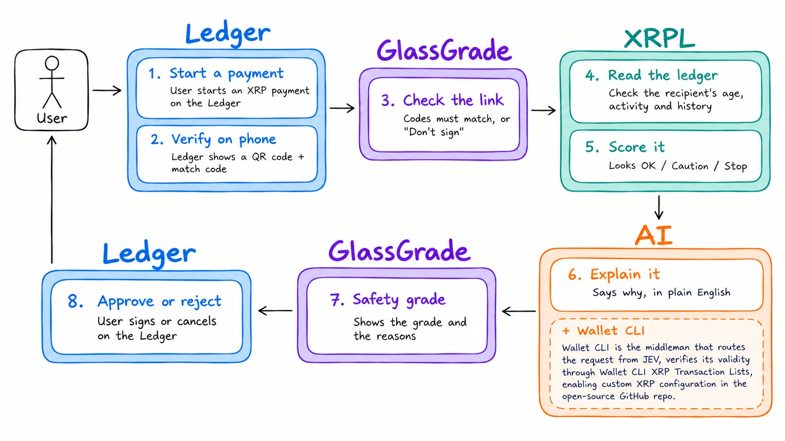

# glassGrade — XRPL Commons Hackathon



A browser-only transaction safety demo. The first component is an interactive Ledger-style wallet mock.

## Run locally

Requires Node.js 22.12 or newer.

```sh
npm ci
npm run dev
```

Open the local URL printed by Vite. Use the transaction picker, review the amount and recipient, continue to the QR placeholder, then approve or reject. Restart or change the preset to replay the walkthrough.

The QR placeholder is intentionally not scannable. No wallet connection, signing, broadcasting, ledger queries, or risk analysis runs in this component. Presets are illustrative UI inputs, not verified ledger fixtures.

`WalletDevice` accepts the shared `TxPayload` and an optional `qrCode` React node for later QR integration. `ARCHITECTURE.md` defines the full application plan.

```sh
npm run build
npm run preview
```
